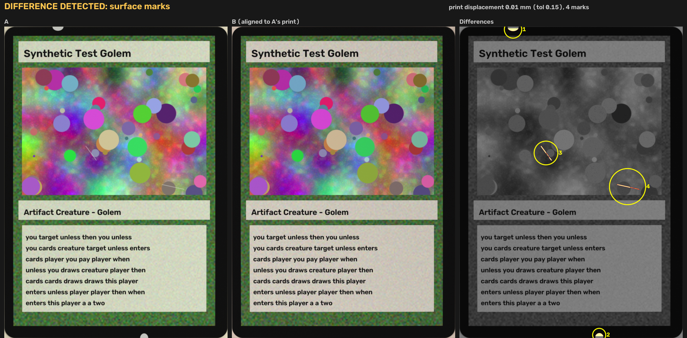

# MTG Copy Fingerprint

Tell two physical copies of the same Magic: The Gathering card apart from photos.

Two Lightning Bolts from the same set share their artwork, text and set symbol, and carry no
serial number. Each physical copy still has a fingerprint of its own:

1. **Centering.** Where the print sits relative to the cut edge. It is set at the factory when
   the sheet is cut, differs from copy to copy by fractions of a millimetre, and stays with the
   card for life.
2. **Surface marks.** Scratches, print specks, scuffs and edge whitening.

Give it two photos and it tells you whether they can be the same physical card, measures the
centering difference between them, and circles the marks found on one copy but not the other.



## Quick start

```
git clone https://github.com/OzturkArda/mtg-copy-fingerprint
cd mtg-copy-fingerprint
pip install -r requirements.txt
python copy_fingerprint.py a.jpg b.jpg --out report.png
```

```
DIFFERENCE DETECTED: centering

Centering   print displacement 0.30 mm (tolerance 0.15) -> differs
            B's print vs A's: +0.30 mm right, +0.00 mm down, +0.00 deg
Marks       0 found
Quality     3625 matched print features, photos at 30 and 28 px/mm
```

`--out` writes the three-panel image above: A, B aligned to A's print, and the differences with
numbered marks. `--json` prints the same result for scripts. The exit code is `0` when no
difference is found, `1` when one is, and `2` on an error such as a photo with no card in it.

| Option | Default | Meaning |
|---|---|---|
| `--tol-mm` | 0.15 | Print displacement above this counts as a centering difference |
| `--min-mark-mm2` | 0.03 | Ignore marks smaller than this area |
| `--mark-sigma` | 6 | Mark threshold, in multiples of the photo noise |

## Taking the photos

- One unsleeved card per photo, shot from straight above, filling most of the frame.
- A plain background that contrasts with the card's border: light for black-bordered cards,
  dark for white-bordered ones.
- Soft, even light with no glare. Switch the flash off.
- JPEG, PNG and HEIC (the iPhone default) all work.
- Fronts and backs both work. Run it once per side.

**Calibrate once for your setup.** Photograph the same card twice, picking it up in between, and
compare the two photos. The print displacement it reports is your noise floor. Set `--tol-mm`
comfortably above it.

## How it works

1. Finds each card's cut outline to sub-pixel precision and straightens the card onto a
   63 x 88 mm canvas, so both images are aligned on their cut edges.
2. Matches thousands of print features between the two images (SIFT). Because the cut edges are
   already aligned, whatever shift and rotation is left over is the centering difference.
3. Aligns B onto A's print, evens out differences in exposure, white balance, lighting and
   focus, and maps what remains as surface marks. Highlights blown out in only one photo are
   left out, so a brighter shot does not read as wear.

## Accuracy

`synth_test.py` cuts copies from one printing with known centering offsets and known marks, then
photographs them with random pose, perspective, lens distortion, shadow, lighting, blur, noise
and JPEG compression at 12 MP. It runs on a synthetic card design, or on a real card scan:

```
python synth_test.py /tmp/shots 8                              # synthetic design
python synth_test.py /tmp/shots 8 --scan bolt.png              # real card art, e.g. a Scryfall PNG
python synth_test.py /tmp/shots 8 --scan angel.png --bg 40,38,36   # white border on a dark table
```

Results, 8 photo pairs per row. The real card art and the card back come from Scryfall scans
(745 x 1040 px) scaled up to the simulated print.

| Test | Synthetic design | Lightning Bolt (M10) | Llanowar Elves (DOM) | Serra Angel (4ED, white border, dark table) | Card back |
|---|---|---|---|---|---|
| Same copy, two photos: no difference | 8/8 | 8/8 | 8/8 | 8/8 | 8/8 |
| Same copy: false marks | 0 | 0 | 0 | 0 | 0 |
| Same copy: largest print displacement (noise floor) | 0.011 mm | 0.015 mm | 0.018 mm | 0.009 mm | 0.011 mm |
| Centering differs by 0.20 to 1.00 mm: detected | 32/32 | 32/32 | 32/32 | 32/32 | 32/32 |
| Centering differs by 0.15 mm (at the default tolerance) | 5/8 | 7/8 | 6/8 | 6/8 | 8/8 |
| Centering differs by 0.10 mm (below the default tolerance) | 0/8 | 0/8 | 0/8 | 0/8 | 0/8 |
| Largest error in the measured centering difference | 0.013 mm | 0.014 mm | 0.015 mm | 0.011 mm | 0.015 mm |
| Tilt differs by 0.3 degrees: detected | 8/8 | 8/8 | 8/8 | 8/8 | 8/8 |
| One copy worn: planted marks located | 32/32 | 29/32 | 23/32 | 26/32 | 32/32 |
| One copy worn: marks with no planted cause | 0 | 0 | 0 | 0 | 0 |
| Different card, photo with no card | rejected | rejected | rejected | rejected | rejected |

These are simulated photos. Real photos add card curl, uneven shadows, glare and dust, so expect a
higher noise floor: calibrate as described above before trusting a centering verdict. The tool
has not yet been tested on photos of physical cards.

## Limits

- Two mint copies whose centering matches within your noise floor cannot be told apart.
- Wear in the outer 0.5 mm of the edge is not compared.
- Foils and sleeved cards reflect too much light for a reliable comparison.
- Dust on the card or the lens shows up as marks, so check the report image before trusting them.

## Tests

```
pip install pytest
pytest
```

The suite checks photo loading, each verdict on simulated photos with known ground truth, and the
command-line exit codes. It runs on Linux, macOS and Windows in GitHub Actions.

## License

MIT

Magic: The Gathering is a trademark of Wizards of the Coast. This is an unofficial fan project.
